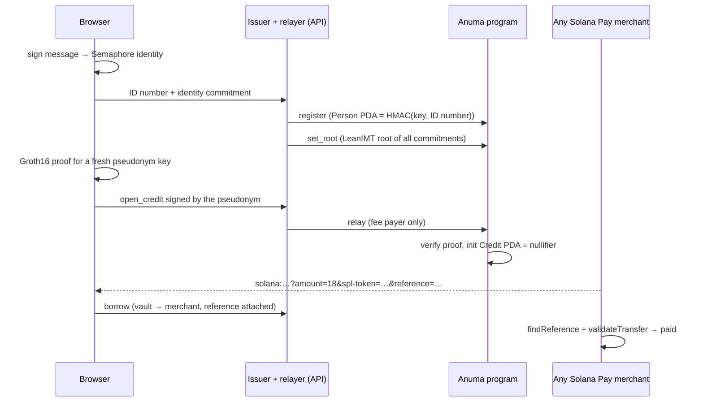

# Anuma

**Private, Sybil-resistant credit on Solana.** Verify once with a KYC issuer. Then open a credit line from a fresh wallet with a zero-knowledge proof: the program knows a verified person owns the line, never which person. One person gets one line, and a default follows the person, not the wallet.

Built for the Dev3pack Global Hackathon (Solana), 27 to 29 November 2026.

## The problem

Every DeFi loan today is over-collateralized. A wallet has no identity and no history a lender can trust, so the only safe loan is one backed by more collateral than it lends. The alternative, linking a real identity to a wallet, exposes that wallet's whole on-chain history to the lender and to everyone else, and it still does not stop one person from farming many wallets.

People who already live on chain have no way to borrow a small amount against their reputation without doxxing themselves.

## How Anuma works

1. **Connect your main wallet.** It proves you are you, once. It never pays or borrows.
2. **Create a private identity.** You sign one fixed message. The browser turns the deterministic Ed25519 signature into a [Semaphore v4](https://semaphore.pse.dev) identity. Nothing is sent.
3. **Verify once.** The issuer checks your government ID (passport, national ID card or driver's licence) and co-signs a `register` transaction. The chain stores only `HMAC(issuer key, ID number)` as the Person PDA seed and your identity commitment as a Merkle leaf. One ID can register once, ever.
4. **Open an anonymous credit line.** Your browser proves membership in the verified group for a brand-new pseudonym wallet (about 0.6 to 0.9 s). The program verifies the Groth16 proof on chain and opens a Credit PDA seeded by the proof's nullifier. A relayer pays fees, so the pseudonym holds no SOL and has no history.

Then you **pay any Solana Pay merchant** from the line, **repay** from the pseudonym, and the limit grows 50% with each on-time repayment (25 → 37.5 → 56.25 → 84.38 → 100 mUSDC). Miss the due time plus grace and anyone can mark the line defaulted.



## Who can see what

| Public on Solana | Known only to you (and the issuer, once) |
| --- | --- |
| The pseudonym wallet of each line | Your main wallet: it signs the verification only and never appears in a credit transaction |
| Limit, debt, due time, on-time repayments | Your ID number: the chain stores a keyed hash that cannot be reversed |
| The nullifier: a one-way tag of the person, identical for every wallet that person tries | Which member you are: the proof hides you among every verified person |

## Why lenders can trust anonymous lines

- **Verified humans only.** `open_credit` verifies a Semaphore v4 Groth16 proof against a recent Merkle root of issuer-registered commitments.
- **One person, one line.** The Credit PDA is seeded by the nullifier `Poseidon(hash(scope), secret)`. A second line from any new wallet produces the same nullifier, and `init` refuses it.
- **Defaults are permanent.** A defaulted line keeps its flag forever, and because of the nullifier the person cannot reset with a new wallet.
- **Proofs are bound to the borrower.** The proof's message is the pseudonym public key, and the program recomputes `keccak256(pubkey) >> 8` on chain, so a copied proof cannot open a line for anyone else.
- **Exposure follows behavior.** Lines start at 25 mUSDC and only grow with on-time repayments, up to 100 mUSDC.

## Works with any Solana Pay merchant

`borrow` pays the merchant's token account from the vault and carries the invoice's `reference` keys as read-only accounts. A merchant finds and validates the payment exactly as it would any Solana Pay payment (reference lookup plus token-balance check). The demo shop, Corner Store, uses no Anuma code at all.

## Architecture

```
programs/anuma/          Anchor 1.x program
  src/lib.rs             initialize, register, set_root, open_credit, deposit, borrow, repay, mark_default
  src/vk.rs              Semaphore v4 depth-16 verifying key in groth16-solana layout (generated)
apps/web/                Next.js 16 app
  app/                   Landing (/), Credit (/app), Pool (/pool), Merchant (/merchant), API routes
  lib/zk/                proof encoding, identity, nullifier and pseudonym derivation, proving
  lib/anuma/             instruction builders, account decoders, issuer/root-sync/relayer logic
  lib/solana-pay.ts      transfer requests, reference lookup, transfer validation
  scripts/               e2e acceptance run, cluster bootstrap, vk generator
```

| Piece | Choice |
| --- | --- |
| Proof system | Semaphore v4 (Groth16 over BN254), Merkle depth 16 |
| On-chain verifier | `groth16-solana` 0.2 through the alt_bn128 syscalls |
| `open_credit` cost | **107,675 compute units** (measured on a local validator) |
| Browser proving | 0.6 to 0.9 s (measured in Chrome) |
| Program size | 312 KB |
| Root history | ring buffer of 8 roots, so a proof survives up to 7 new registrations |
| Client | `@solana/web3.js` v1 with hand-written fixed-size Borsh encoders, checked against the IDL |

## Verification

- `pnpm check`: lint, 31 unit tests and the production build. The tests pin the browser proof encoding to bytes a Rust `groth16-solana` verifier accepted, compare every instruction's discriminator, account order and signer flags with the IDL, and cover the relayer's signing rules.
- `pnpm --filter web e2e`: 24 checks on a local validator with real proofs through the same relayer code the app uses. It covers registration, a duplicate ID number, root sync, open credit, a proof made for another wallet, borrow over limit, a Solana Pay payment validated by reference, repayment and limit growth, default, and a defaulted person retrying with a new wallet.

## Run it locally

Prerequisites: Node 24, pnpm 11, and for the program Rust with Anchor CLI 1.1.2 and Solana CLI 3.1.10 (on Windows, inside WSL).

```bash
pnpm install

# Build the program (keep the target dir outside the repo on WSL for speed)
CARGO_TARGET_DIR=$HOME/anuma-target anchor build

# Start a local validator with the program preloaded
solana-test-validator --reset --bpf-program 9k1zFVABWqqDQRJbfwQpucxWdbN7gJnTCbFFv5RL3nKd $HOME/anuma-target/deploy/anuma.so

# Acceptance run against it
pnpm --filter web e2e

# App against the local validator: copy apps/web/.env.example to .env.local and fill it,
# fund the server key on the validator, then bootstrap and start
cd apps/web
SOLANA_RPC_URL=http://127.0.0.1:8899 node --disable-warning=MODULE_TYPELESS_PACKAGE_JSON scripts/bootstrap.mts
NEXT_PUBLIC_SOLANA_RPC=http://127.0.0.1:8899 SOLANA_RPC_URL=http://127.0.0.1:8899 pnpm dev
```

Bootstrap creates the mock USDC mint, initializes the program with the demo terms (2-minute loans, 30-second grace), funds the vault and registers seven demo members, so the first real user already hides among eight people.

## Deploy to devnet

1. Fund the Solana CLI default wallet with at least 2.7 devnet SOL (https://faucet.solana.com).
2. Put the program keypair at `$HOME/anuma-target/deploy/anuma-keypair.json` (it keeps the program ID `9k1zFVAB…3nKd`).
3. Run `scripts/deploy-devnet.sh`. It refuses to start when the wallet holds too little SOL, builds, deploys, tops up the server key and refreshes `apps/web/lib/anuma/idl.json`.
4. Run `node --disable-warning=MODULE_TYPELESS_PACKAGE_JSON scripts/bootstrap.mts` in `apps/web` with `.env.local` pointing at devnet.
5. Host `apps/web` (Next.js) with the variables from `apps/web/.env.example`. `ANUMA_SERVER_SECRET`, `ANUMA_ISSUER_SECRET` and a keyed `SOLANA_RPC_URL` are server-only and must never get a `NEXT_PUBLIC_` prefix.

## Try it

1. Open `/app`, connect a wallet (Phantom, Solflare, Backpack, or the in-browser burner wallet for a quick look).
2. Sign once to create your private identity, then verify with any 6 to 20 character ID number.
3. Generate the proof and open your line: about a second in the browser, no SOL needed.
4. Open `/merchant` in another tab, create an invoice, paste its link on `/app` and pay. The store tab turns to Paid.
5. Get test mUSDC on the pseudonym, repay, and watch the limit grow to 37.50.
6. Try a second line from a new wallet: the program refuses it. Let a loan pass its due time and grace to see a permanent default.

## Honest limits of this demo

- **Demo issuer.** Any ID number of 6 to 20 letters or digits passes. A production issuer would verify the document with a licensed identity provider before co-signing, and key the person by issuing country, document type and number.
- **One server key.** Admin, issuer, relayer and mock-USDC mint authority share one key. Production would split them, and root posting could move to an on-chain Poseidon tree.
- **Relayer metadata.** The relayer sees IP addresses and timing. Production should accept relayed transactions over Tor or a mixnet, or let users pick any relayer.
- **No interest and one open loan per line.** The credit logic is deliberately minimal to show the identity layer.
- **Devnet and mock USDC** only.

## Built during the hackathon

Everything in this repository was written during the hackathon (27 to 29 November 2026). Nothing comes from earlier projects. It builds on open-source libraries: Anchor, `groth16-solana`, Semaphore v4 (`@semaphore-protocol/*`), `@solana/web3.js`, the Solana wallet adapter and Next.js.

## License

MIT
